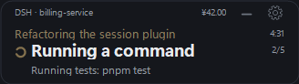
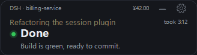
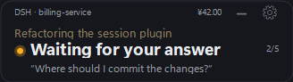
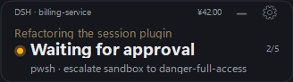
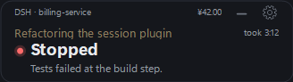
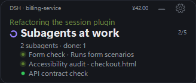
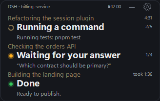
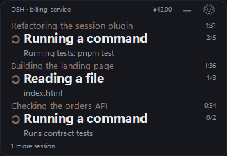
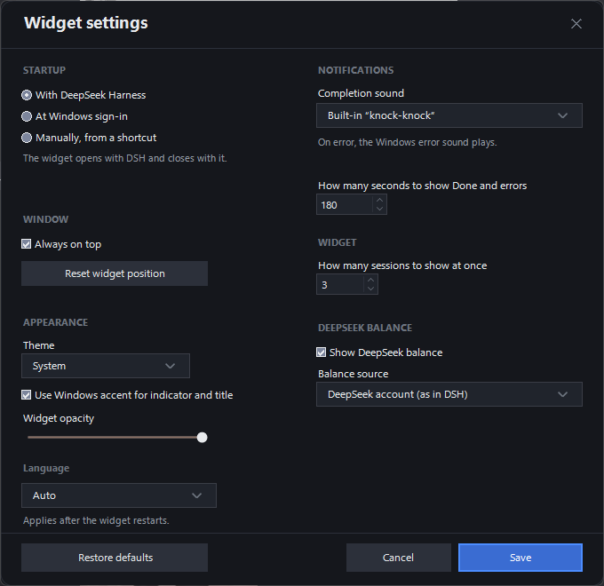
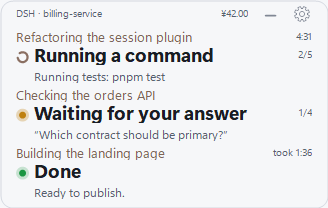

**English** · [Русский](README.ru.md) · [简体中文](README.zh-CN.md) · [Website](https://muratovmikhail.github.io/dsh-widget/)

[](https://github.com/MuratovMikhail/dsh-widget/actions/workflows/ci.yml)
[](https://github.com/MuratovMikhail/dsh-widget/releases/latest)
[](LICENSE)
[](#requirements)

[Download the latest release](https://github.com/MuratovMikhail/dsh-widget/releases/latest)


# DSH Widget — a DeepSeek Harness status widget for Windows 10/11

A floating desktop widget that shows **what DeepSeek Harness (DSH) is doing right now**,
**what is waiting for your answer**, and **what has already finished**. An unofficial widget: DSH is not modified,
the widget only reads the session logs that the app already writes to disk.

> A small unofficial Windows desktop widget for DeepSeek Harness: what the agent is doing now,
> what is waiting for your answer, and what has just finished. It reads local session logs only.

Author: **Mikhail Muratov**.



---

## What it shows

- **Project and session** — in the header `DSH · billing-service`, below it the session name and what exactly is happening.
- **Status** — "Thinking…", "Running a command", "Reading a file", "Searching the web", "Started a subagent",
  and so on, with a short explanation: which command, which file, which query.
- **Time** — how long the current turn has been running (`4:32`), or the finished turn's duration (`took 3:12`).
- **Plan** — if the agent keeps a `todo_write` list, `2/5` is visible to the right of the status.
- **Waiting for an answer** — the status "Waiting for your answer" and the question text ("Where should I commit the changes?").
- **Approval** — if DSH asks for permission, the widget says "Waiting for approval" and names the tool.
- **Completion and error** — "Done" with a preview of the answer (3 minutes) or "Stopped" with a red dot
  if the turn ended with an error. An error does not disappear just because the DSH window was in focus: it stays
  until you click the block or `doneVisibleSec` expires.
- **Subagents** — if the parent turn has finished but child sessions are still running, the widget does not say
  "Done": it says "Subagents at work", shows their number and what the most recent one is doing.
- **Balance** — an optional amount in the header; below 5 units it is highlighted in amber.
- **Completion sound** — a quiet sound; on error the system error sound plays. There are no pop-up windows.
- **Tray icon** with a menu; the icon is static and the current state is in its tooltip.
- **Only when relevant** — the widget is visible only when there is work, a wait, subagents, or a recent "Done";
  when everything is finished and viewed, it hides and comes back on new work.

Widget states:

| State | What it looks like |
|---|---|
| Working | spinner in the Windows accent color, turn time, tool detail |
| Waiting for your answer | amber pulsing dot, the question text |
| Waiting for approval | amber dot, the tool and the reason |
| Subagents at work | purple spinner, the number and what the most recent one is doing |
| Done | green dot with a soft halo, a preview of the answer (3 minutes by default) |
| Error | red dot with a halo, "Stopped", preview/reason |
| Idle / offline | gray dot, "No active tasks" or "Engine offline" |

More widget states (demo data, dark theme):







---

## Quick answers

**What is DSH Widget?**  
A small Windows status widget for **DeepSeek Harness (DSH)**. It shows the current agent turn,
plan approvals, subagent activity, completion and errors without opening the DSH window.

**Does it work with a portable DeepSeek Harness?**  
Yes. The installer looks for DSH in the registry, the running process, `DSH_HOME`, the default
profile and the uninstall entry. If no profile is found, the widget still installs in manual mode.

**Does it send my data anywhere?**  
No. It reads local DSH session journals and the optional balance request. No telemetry, no
account password, no prompt contents are uploaded. See [PRIVACY.md](PRIVACY.md).

**Does it need administrator rights?**  
No. It installs per-user to `%LOCALAPPDATA%\Programs\DSH Widget`.

**Which Windows versions are supported?**  
Windows 10 (21H2+) and Windows 11, x64. Windows PowerShell 5.1 is used.

**Why does SmartScreen say "Unknown publisher"?**  
The installer is currently unsigned. Verify the SHA-256 from the release page, then use
"More info" → "Run anyway".

---

## Installation

### Installer (recommended)

`DSHWidget-Setup-1.0.7.exe` (about 3 MB) — no administrator rights, installs to
`%LOCALAPPDATA%\Programs\DSH Widget`.

1. Run it; if SmartScreen warns "Unknown publisher", click "More info" → "Run anyway"
   (the file is not signed with a certificate).
2. Choose the installation folder (default `%LOCALAPPDATA%\Programs\DSH Widget`), the launch mode
   (see below) and, if you like, a desktop shortcut.
3. To uninstall — "Settings → Apps → DSH Widget → Uninstall". The widget is closed before removal,
   shortcuts and autostart are removed; the installer asks separately about `config.json`.

| Mode | What happens |
|---|---|
| **With DeepSeek Harness** (default) | a service plugin `dsh-widget-bridge` is installed into the DSH profile: the widget appears when DSH starts and closes with it. If the plugin fails to work, the widget exits on its own 5 minutes after DSH is closed |
| **At Windows sign-in** | a shortcut in "Startup": the widget runs permanently, including when DSH is closed. The plugin is not installed |
| **Manual only** | no autostart: the widget is launched from a Start menu shortcut |

If DSH has never been opened on the computer, the installer still finishes: a background finisher
waits for the first DSH profile, installs the bridge after DSH closes, and enables the
"With DeepSeek Harness" mode automatically. If the widget or the PC is restarted before that,
the finisher is retried at the next sign-in through `RunOnce`. If it still does not finish,
run the installer again — it will install the plugin immediately.

### From the archive / sources

1. Unpack the archive and double-click **`start-widget.vbs`** (it launches PowerShell without a console window).
2. Shortcuts in the Start menu and on the desktop: `powershell -ExecutionPolicy Bypass -File .\install.ps1`.
3. Autostart: `install.ps1 -Autostart`; remove shortcuts and autostart: `install.ps1 -Remove`.
4. Rebuild the installer: `build-installer.ps1` (Inno Setup 6.3+ is needed only on the build machine).

---

## Controls

| Action | Result |
|---|---|
| Drag the widget | changes its position, which is saved in `config.json` |
| The gear in the top-right corner | the settings window |
| The "—" button next to the gear | minimize the widget to the tray |
| Left-click the tray icon | show/hide the widget |
| Right-click the widget | the tray menu |
| Click the session block | if the session is open in a separate DSH window, focuses exactly that window (by title); otherwise opens DSH |
| Double-click the widget | switches to DeepSeek Harness (or starts it) |
| Right-click the tray | "Show/Hide widget", "Open DeepSeek Harness", "Settings…", "About", "Refresh balance", "Exit" |
| Double-click the tray | open DeepSeek Harness |

The tray icon is the branded "D". It does not change color or shape; hover over it to see the current
state in the tooltip. The widget itself remains the primary place for the full status.

> **The tray icon.** By default Windows 10/11 tucks new icons into the "hidden" area — under the `^` arrow by the clock.
> If you cannot see the icon, click `^` or enable it in "Settings → Personalization → Taskbar →
> Other system tray icons". The whole menu is still available without the tray: the gear on the widget
> and a right-click on it.

### Multiple DSH windows

Active sessions are shown **as equals**: the widget is a stack of identical blocks, each with its own name,
status, detail, and time. Idle sessions do not get into the stack — only working ones, ones waiting for an answer,
and recently finished ones.



If there are more active sessions than fit, the first ones by priority are shown, and "1 more session" is written at the bottom:



The number of sessions to display is set by the "How many sessions to show at once" setting (1–3), 3 by default.
The widget grows upward, the bottom edge stays in place. Clicking a block focuses this session's separate
window in DSH if it is open; otherwise it just opens DSH. The widget cannot switch tabs inside the main
DSH window — DSH has no external API for that.

**Viewed tasks remove themselves.** If the DSH window with a finished session comes into focus
(DSH titles the window "<session> — DeepSeek Harness"), the block disappears from the widget immediately — like a green dot
you have already seen. Unviewed ones stay for `doneVisibleSec` seconds (180 by default). If a new turn
starts in the session, it appears again.

By default the choice is "sticky": blocks are not reordered on every neighbour's event. The main session
for the tray and notifications switches only when the current one has gone to sleep or when an agent in another window has asked a question.
You can pin a specific session only via `config.json` (`pinnedSessionId`) — there is no separate item in the UI;
the value is applied when the engine starts.

---

## How it works

```
~/.dsh/sessions/<project>/<session>/session.v4.jsonl.zstd
        │  a stream of appended zstd frames, NDJSON events inside
        ▼
widget-engine.js      (Node, no dependencies)
   turn/start · step/start · tool/call · tool/result · assistant/message · turn/end · job/*
        │  http://127.0.0.1:45871/status   (localhost only, read-only)
        ▼
widget-ui.ps1         (PowerShell 5.1 + WinForms)
   widget · tray · sound · launching DSH
```

- **DSH is not modified.** The engine only reads the session logs that DSH already writes to disk,
  plus the account grant for the balance request. The widget itself changes nothing in DSH: the only exception is an optional
  bridge plugin `dsh-widget-bridge`, which only starts the widget together with DSH.
- **Incremental reads:** after the first pass the engine reads only new bytes, not the whole log.
  This matters: logs can be 8–10 MB.
- **Only balance requests go outside** — to `platform.deepseek.com` (or `api.deepseek.com` with your key).
  Everything else stays on `127.0.0.1`.
- **Works with any DSH** that writes sessions to `%USERPROFILE%\.dsh` (or to the directory from the `DSH_HOME` variable):
  the desktop app, `dsh web`, headless.
- Node is taken from the installed DSH (`...\DeepSeek Harness\resources\runtime\primary-runtime\dependencies\node\bin\node.exe`),
  nothing needs to be installed separately.

Why a log and not an internal API: the log already contains everything needed — event types, tool names, arguments,
time, and the turn-end marker — and it is stable across versions (the `session.v4` format).

---

## Privacy and security

- The HTTP engine listens **only on `127.0.0.1`**; CORS is not served, and requests with an `Origin` and a foreign `Host` get 403.
- The widget reads:
  - `%USERPROFILE%\.dsh\sessions\**\session.v*.jsonl.zstd` — session logs, read-only;
  - `%USERPROFILE%\.dsh\.credentials.yaml` — **only** if balance is enabled and `balanceSource = account`
    (in `apikey` and `off` modes the file is not opened);
  - its own `config.json` in the widget folder.
- The token is never stored or logged anywhere; the request goes only to the issuer from the grant itself,
  and only if it is an `https` address of the form `*.deepseek.com`.
- There is no telemetry. The archive for friends does not contain `config.json`, logs, keys, or user paths;
  `release.ps1` checks this itself, and `tools/audit-release.ps1` checks it again against the finished archive.

---

## Balance

The amount in the header is an optional feature. The mode is set by the `balanceSource` key:

| `balanceSource` | What happens |
|---|---|
| `account` (default) | reads the grant that DeepSeek Harness already stores in `%USERPROFILE%\.dsh\.credentials.yaml`, and queries the wallet balances at `platform.deepseek.com` — the same source as in the DSH account settings |
| `apikey` | calls the official `https://api.deepseek.com/user/balance` with the key from `balanceApiKey` |
| `off` | reads and requests nothing, the balance is hidden |

Only the amount is shown. If a refresh fails, the widget keeps the last known number,
but marks it with a tilde: `~¥29.76`. An amount of 5 or below is highlighted in amber. If there is no data
or balance is turned off, the header space is simply not taken up — there is no dash.

The balance is refreshed once per `balanceIntervalSec` (300 s by default), after each finished turn,
and manually — via the tray icon menu → "Refresh balance". To turn it off completely: `"balance": false`
or the "Off" source in the settings.

```json
{ "balanceSource": "apikey", "balanceApiKey": "sk-..." }
```

The key is stored in `config.json` in plain text — like most settings. If that matters,
use the `account` mode: no separate key is needed then.

---

## Settings

The gear in the top-right corner of the widget, or the tray → **"Settings…"**.



| Section | What is configured |
|---|---|
| Launch | "With DeepSeek Harness" / "At Windows sign-in" / "Manually, from a shortcut"; one hint explains the selected mode. If the plugin is not installed, the "with DSH" mode is unavailable |
| Window | always on top, reset the widget position |
| Appearance | theme (system / light / dark), indicator and title in the Windows accent color, widget opacity 50–100 % |
| Notifications | completion sound (built-in "knock-knock" / Windows system sound / no sound), how many seconds to show Done and errors (30–3600 s) |
| Widget | how many sessions to show at once (1–3, all equal) |
| Language | Auto / English / Русский / 简体中文; applies after the widget restarts |
| DeepSeek balance | whether to show it, where to take it from (DeepSeek account / own key / off), the key. The key field appears only for "Own DeepSeek key" |

Changes are applied with the "Save" button — no widget restart is needed. If the balance source
or key changes, the balance is re-requested immediately. The "Restore defaults" button returns the default values,
and "Reset widget position" puts the widget back in the bottom-right corner.

The "same as system" theme reads the Windows setting and picks up a switch on the fly:



The engine port and the balance refresh interval are not shown in the settings window — they can be set only in `config.json`.

## Languages

English is the primary language; Russian and Simplified Chinese are included. By default the widget follows
the Windows UI language and falls back to English. Change it in **Settings → Language**: Auto / English /
Русский / 简体中文. The new language is applied after the widget restarts. The widget, tray, settings and About
window are translated; session titles, commands and other data from DSH are shown as-is.

## About

Tray → **"About"**: version, author, a short description, the MIT license, a GitHub link
(it will appear once the repository is published), and an "Open widget folder" button (where `config.json`
and `widget.log` also live). The same menu is available by right-clicking the widget. The window uses the current theme —
light or dark.

## config.json

Created automatically next to the scripts. It is not included in the archive for friends.

| Key | Default | Meaning |
|---|---|---|
| `port` | `45871` | local engine port |
| `sound` | `true` | sound when work finishes |
| `soundMode` | `builtin` | `builtin` (built-in "knock-knock"), `system` (Windows), `off` (no sound) |
| `theme` | `system` | appearance: `system` / `light` / `dark` |
| `accentBar` | `true` | indicator and title colors as in Windows |
| `opacity` | `100` | widget opacity, % (50–100) |
| `topMost` | `true` | keep the widget above other windows |
| `x`, `y` | — | widget position (saved when dragging) |
| `launchMode` | `''` | `plugin` / `startup` / `manual` — the mode chosen at install time |
| `autostart` | `false` | mirrors the autostart state (a shortcut in "Startup") |
| `exitWhenDshClosedMin` | `10` | how many minutes after DSH is closed the widget exits; `0` — never. In plugin mode the installer sets `5` |
| `balance` | `true` | show the DeepSeek balance in the widget |
| `balanceSource` | `account` | `account` / `apikey` / `off` — where to take the amount from |
| `balanceApiKey` | `''` | your own DeepSeek key (instead of the DSH account grant) |
| `balanceIntervalSec` | `300` | how often to refresh the balance, seconds (minimum 60) |
| `doneVisibleSec` | `180` | how long to show Done and errors, seconds (30–3600) |
| `maxSessions` | `3` | how many sessions to show at once (1–3) |
| `language` | `auto` | UI language: `auto` (Windows UI, English fallback) / `en` / `ru` / `zh-CN` |
| `pinnedSessionId` | `null` | pinned session for advanced mode (there is no UI item for it) |

---

## Notification sound

By default the built-in sound `assets\notify.wav` plays — a quiet double knock on wood
(Pixabay, author HerrParadox, "Soft Wood Knock Double"; the first two of five knocks are kept,
mono 44.1 kHz — `tools/prepare-sound.py --knocks 2 --peak -20`). Pixabay Content License:
free for commercial use, no attribution required, the sound itself may not be distributed separately.

In the settings, section "Notifications":

- **Built-in "knock-knock"** — works right after installation;
- **Windows system sound** — the standard notification sound;
- **No sound**.

On a turn error the system error sound plays. There is no separate "Test" button: you hear the sound
at the next completion.

The error sound plays only when a turn fails, not when it succeeds. There is no "custom file"
mode in the current version; `soundFile` from older configs is ignored.

---

## Requirements

- Windows 10 (1809+, x64) and Windows 11 (x64). Tested on Windows 11; Windows 10 uses the API/font fallbacks described in the code and is not yet physically tested by the author.
- Windows PowerShell 5.1 — built into the system.
- Node with `zlib` zstd support (22.15+; DSH currently bundles 24.x) — no separate installation needed.

### Windows 10 notes

On Windows 11 the window uses DWM rounded corners. On Windows 10 the widget falls back to a
rounded window region; `Segoe UI Variable` is absent, so Segoe UI and Segoe MDL2 Assets are used.
The Chinese UI uses Microsoft YaHei UI. Windows 10 S mode, 32-bit Windows, and Windows 10 ARM are
not supported. This compatibility is based on API and font fallbacks; the author has physically
tested Windows 11 only. Windows 10 is past the end of regular Microsoft support (14 October 2025);
Windows 10 support here is best-effort.

---

## Limitations

- **This is not a Windows 11 widgets board widget.** The board only accepts packaged MSIX applications
  with a Widget Provider (Windows App SDK, package signing, COM activator registration). That is a separate build
  in C#/WinUI. The widget described here is an ordinary window on top of the desktop: the same idea, but without
  MSIX packaging, mandatory code signing, or administrator rights.
- "What it does" is known at the level of steps and tool calls. While the model is generating text, you see
  "Thinking…" — streamed text does not reach the log until the message is complete.
- The subagent tree is tracked via the logs of child sessions (`parentSession`, `delegationDepth`):
  the widget waits until the whole tree settles. If a subagent "hangs" without events for more than 30 minutes,
  it stops counting as active.
- If several DSH windows are open, the widget shows active sessions as a stack, but the main session
  for the tray and notifications is chosen by the "stickiness" rule.
- A turn interrupted by closing DSH is not considered current work and does not occupy the widget.
- Background jobs (`job/*`) are counted by the engine for diagnostics but are not shown in the widget; the history of finished
  turns is not stored.
- The widget is designed for a fixed 328 px. At Windows scaling of 125–150 % it is scaled by the system
  as a whole (slightly softer, but without clipping); at 100 % it looks as sharp as possible.
- Windows only: the UI is built on WinForms.

---

## Diagnostics

```powershell
# what the widget sees right now
powershell -ExecutionPolicy Bypass -File .\tools\status.ps1

# raw engine response
Invoke-RestMethod http://127.0.0.1:45871/status | ConvertTo-Json -Depth 6
```

- "Engine offline" — `node.exe` was not found, the port is taken by another process, or DSH has never been started.
- The widget is empty / "No active tasks" — there are no session logs in `%USERPROFILE%\.dsh\sessions` yet.
- After editing a `.ps1`, Cyrillic turned into "Сообщение" — the file was saved without a BOM.
  Re-save it: `powershell -File .\tools\fix-bom.ps1 -Path .\widget-ui.ps1`.
- The detailed log is `widget.log` next to the widget (rotated after 256 KB).
- **The installer says "Unable to create folder …is-*.tmp. Error 5: Access is denied"** if you run it
  directly from the project folder inside the DSH workspace: that folder has special ACLs. Copy `DSHWidget-Setup-*.exe`
  to the desktop or to "Downloads" and run it from there — from an ordinary directory the installation proceeds normally.
  On the recipient's machine (and when run from "Downloads") this problem does not occur.

---

## Files

| File | Purpose |
|---|---|
| `widget-engine.js` | reads session logs, serves the state over HTTP (Node) |
| `widget-ui.ps1` | widget, tray, sound (PowerShell + WinForms) |
| `assets\DSHWidget.ico` | the branded icon: shortcuts, settings window, installer |
| `assets\DSHWidget-Tray.ico` | simplified static tray icon |
| `assets\notify.wav` | built-in completion sound |
| `start-widget.vbs` | launches without a console window |
| `install.ps1` | shortcuts in the Start menu and on the desktop, autostart |
| `release.ps1` | builds `dsh-widget-1.0.7.zip` without personal data |
| `build-installer.ps1`, `installer.iss` | builds `dist\DSHWidget-Setup-1.0.7.exe` (requires Inno Setup) |
| `plugin-src\`, `plugin\` | the service bridge plugin `dsh-widget-bridge` |
| `tools\status.ps1` | human-readable engine status |
| `tools\test-subagents.js` | subagent logic test on a synthetic DSH_HOME |
| `tools\test-selection.js` | "sticky" window selection test with two active sessions |
| `tools\test-ack.js` | "viewed" and unpin test |
| `tools\test-content.js` | question, approval, error, plan, incremental reads, CORS |
| `tools\make-previews.ps1` | re-captures `docs\<lang>\preview-*.png` |
| `tools\audit-release.ps1` | checks the archive for personal data |
| `tools\fix-bom.ps1` | re-saves scripts as UTF-8 with BOM |
| `tools\stop-widget.ps1` | stops the widget and the engine via `runtime.json` |
| `config.json` | settings (created on the first change, not included in the archive) |
| `docs\` | GitHub Pages landing page and previews |
| `LICENSE`, `CHANGELOG.md` | the MIT license and the version history |
| `PRIVACY.md` | privacy policy: local data and the optional balance request |
| `THIRD_PARTY_NOTICES.md` | third-party asset notices |

---

## Build and verification

```powershell
# engine tests
node tools\test-subagents.js
node tools\test-selection.js
node tools\test-ack.js
node tools\test-content.js

# widget previews (requires a desktop, Windows PowerShell)
powershell -ExecutionPolicy Bypass -File .\tools\make-previews.ps1

# archive for friends and its audit
powershell -ExecutionPolicy Bypass -File .\release.ps1 -Version 1.0
powershell -ExecutionPolicy Bypass -File .\tools\audit-release.ps1

# installer
powershell -ExecutionPolicy Bypass -File .\build-installer.ps1 -Version 1.0.7
```

`config.json`, logs, `selftest-*.png`, `dist/`, `_backup/` must not end up in the archive/repository.
`release.ps1` fails if a user name or home path has leaked into the package;
`audit-release.ps1` checks the finished zip once more.

---

## License

The code is MIT, see [LICENSE](LICENSE). DeepSeek Harness and its name belong to their respective owners;
this is an unofficial project. The sound `assets\notify.wav` is under the Pixabay Content License (see the "Notification sound" section).

---

## Contributing

See [CONTRIBUTING.md](CONTRIBUTING.md) for local checks and pull-request rules. Report
security issues privately via [SECURITY.md](SECURITY.md).

## Publishing (for the author)

```powershell
# once: name and email for commits
git config --global user.name "Your Name"
git config --global user.email "<email>"

git init -b main
git add .
git commit -m "DSH Widget 1.0.7"
```

Create an empty repository `dsh-widget` on GitHub, then:

```powershell
git remote add origin https://github.com/MuratovMikhail/dsh-widget.git
git push -u origin main
```

Publishing is automatic on a version tag:

```powershell
git tag -a v1.0.7 -m "DSH Widget 1.0.7"
git push origin v1.0.7
```

`.github/workflows/release.yml` builds `dsh-widget-1.0.7.zip`, `DSHWidget-Setup-1.0.7.exe`, and
`SHA256SUMS.txt`, then creates the GitHub Release. No manual asset upload and no `gh` are needed.
The CI workflow runs the engine tests and an encoding check on every push.
