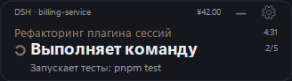
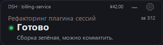
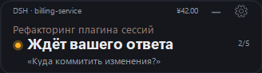
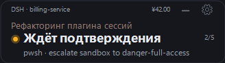
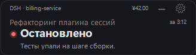
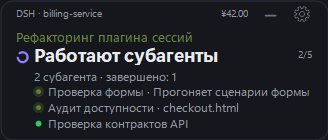
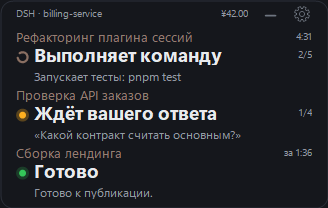
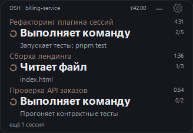
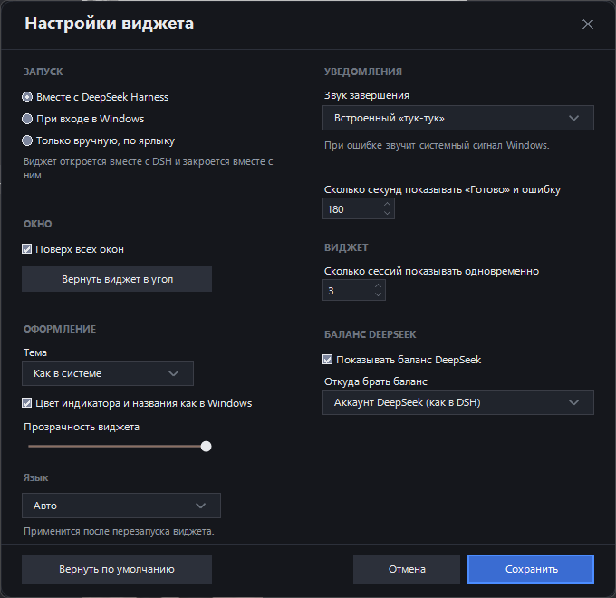
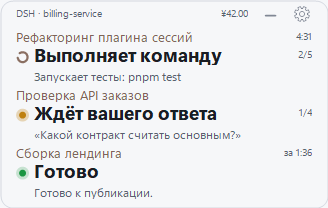

[English](README.md) · **Русский** · [简体中文](README.zh-CN.md)

[](https://github.com/MuratovMikhail/dsh-widget/actions/workflows/ci.yml)
[](https://github.com/MuratovMikhail/dsh-widget/releases/latest)
[](LICENSE)
[](#requirements)

[Скачать последний релиз](https://github.com/MuratovMikhail/dsh-widget/releases/latest)


# DSH Widget — виджет состояния DeepSeek Harness для Windows 10/11

Плавающий виджет на рабочем столе, который показывает, **чем занят DeepSeek Harness прямо сейчас**,
**что ждёт вашего ответа** и **что уже завершилось**. Неофициальный виджет: DSH не изменяется,
виджет только читает журналы сессий, которые приложение и так пишет на диск.

> A small unofficial Windows desktop widget for DeepSeek Harness: what the agent is doing now,
> what is waiting for your answer, and what has just finished. It reads local session logs only.

Автор: **Муратов Михаил**.



---

## Что показывает

- **Проект и сессию** — в шапке `DSH · billing-service`, ниже название сессии и что именно происходит.
- **Состояние** — «Думает…», «Выполняет команду», «Читает файл», «Ищет в интернете», «Запустил субагента»
  и т. д., с короткой расшифровкой: какая команда, какой файл, какой запрос.
- **Время** — сколько идёт текущий ход (`4:32`) или сколько заняло завершение (`за 3:12`).
- **План** — если агент ведёт `todo_write`, справа от статуса видно `2/5`.
- **Ожидание ответа** — статус «Ждёт вашего ответа» и текст вопроса: «Куда коммитить изменения?».
- **Подтверждение** — если DSH спрашивает разрешение, виджет пишет «Ждёт подтверждения» и инструмент.
- **Завершение и ошибку** — «Готово» с превью ответа (3 минуты) или «Остановлено» с красной точкой,
  если ход закончился ошибкой. Ошибка не исчезает от того, что окно DSH было в фокусе: она держится
  до клика по блоку или до истечения `doneVisibleSec`.
- **Субагентов** — если родительский ход закончился, а дочерние сессии ещё работают, виджет не пишет
  «Готово»: «Работают субагенты», их число и чем занят самый свежий.
- **Баланс** — необязательная сумма в шапке; ниже 5 единиц подсвечивается янтарным.
- **Сигнал о завершении** — тихий звук; при ошибке звучит системный сигнал Windows. Всплывающих окон нет.
- **Трей-иконку** с меню; иконка статичная, состояние показывается в подсказке.
- **Только по делу** — виджет виден, лишь когда есть работа, ожидание, субагенты или свежее «Готово»;
  когда всё завершено и просмотрено, он прячется и возвращается при новой работе.

Состояния виджета:

| Состояние | Как выглядит |
|---|---|
| Работает | спиннер в цвете акцента Windows, время хода, деталь инструмента |
| Ждёт вопроса | янтарная пульсирующая точка, текст вопроса |
| Ждёт подтверждения | янтарная точка, инструмент и причина |
| Работают субагенты | фиолетовый спиннер, число и занятие самого свежего |
| Готово | зелёная точка с мягким ореолом, превью ответа (по умолчанию 3 минуты) |
| Ошибка | красная точка с ореолом, «Остановлено», превью/причина |
| Простой / офлайн | серая точка, «Нет активных задач» или «Нет связи с движком» |

Ещё состояния (демо-данные, тёмная тема):







---

## Установка

### Установщик (рекомендуется)

`DSHWidget-Setup-1.0.7.exe` (около 3 МБ) — без прав администратора, ставится в
`%LOCALAPPDATA%\Programs\DSH Widget`.

1. Запустить; при предупреждении SmartScreen «Неизвестный издатель» — «Подробнее» → «Выполнить всё равно»
   (файл не подписан сертификатом).
2. Выбрать папку установки (по умолчанию `%LOCALAPPDATA%\Programs\DSH Widget`), режим запуска
   (см. ниже), при желании — ярлык на рабочем столе.
3. Удаление — «Параметры → Приложения → DSH Widget → Удалить». Перед удалением виджет закрывается,
   ярлыки и автозапуск убираются; про `config.json` установщик спросит отдельно.

| Режим | Что происходит |
|---|---|
| **Вместе с DeepSeek Harness** (по умолчанию) | в профиль DSH ставится служебный плагин `dsh-widget-bridge`: виджет появляется при запуске DSH и закрывается вместе с ним. Если плагин не сработал, виджет сам завершится через 5 минут после закрытия DSH |
| **При входе в Windows** | ярлык в «Автозагрузке»: виджет работает постоянно, в том числе когда DSH закрыт. Плагин не ставится |
| **Только вручную** | никакого автозапуска: виджет запускается ярлыком из «Пуска» |

Если DSH на компьютере ещё ни разу не открывали, установщик всё равно завершится: фоновый finisher
дождётся первого профиля DSH, поставит bridge после закрытия DSH и сам включит режим
«Вместе с DeepSeek Harness». Если виджет или компьютер перезагрузят раньше, попытка повторится
при следующем входе через `RunOnce`. Если и это не сработало — запустите установщик ещё раз,
он поставит плагин сразу.

### Из архива / исходников

1. Распаковать архив, дважды кликнуть **`start-widget.vbs`** (запускает PowerShell без окна консоли).
2. Ярлыки в «Пуск» и на рабочем столе: `powershell -ExecutionPolicy Bypass -File .\install.ps1`.
3. Автозапуск: `install.ps1 -Autostart`; убрать ярлыки и автозапуск: `install.ps1 -Remove`.
4. Пересборка установщика: `build-installer.ps1` (Inno Setup 6.3+ нужен только на машине сборки).

---

## Управление

| Действие | Результат |
|---|---|
| Перетащить виджет | меняет позицию, она запоминается в `config.json` |
| Шестерёнка в правом верхнем углу | окно настроек |
| Кнопка «—» рядом с шестерёнкой | свернуть виджет в трей |
| Левый клик по иконке в трее | показать/скрыть виджет |
| Правый клик по виджету | меню трея |
| Клик по блоку сессии | если сессия открыта в отдельном окне DSH — фокусирует именно его (по заголовку); иначе открывает DSH |
| Двойной клик по виджету | переключает на DeepSeek Harness (или запускает его) |
| Правый клик по трею | «Показать/Скрыть виджет», «Открыть DeepSeek Harness», «Настройки…», «О программе», «Обновить баланс», «Выход» |
| Двойной клик по трею | открыть DeepSeek Harness |

Значок трея — фирменный «D». Он не меняет цвет и форму; наведите на него курсор, чтобы увидеть
текущее состояние в подсказке. Основное место для полного статуса — сам виджет.

> **Иконка в трее.** Windows 10/11 по умолчанию убирает новые значки в «скрытые» — под стрелку `^` у часов.
> Если иконки не видно, нажмите `^` или включите её в «Параметры → Персонализация → Панель задач →
> Другие значки в области уведомлений». Всё меню при этом доступно и без трея: шестерёнка на виджете
> и правый клик по ней.

### Несколько окон DSH

Активные сессии показываются **равнозначно**: виджет — это стек одинаковых блоков, у каждого своё название,
статус, деталь и время. Простаивающие сессии в стек не попадают — только работающие, ожидающие ответа
и недавно завершённые.



Если активных больше, чем помещается, показываются первые по приоритету, а внизу пишется «ещё 1 сессия»:



Сколько сессий показывать — настройка «Сколько сессий показывать одновременно» (1–3), по умолчанию 3.
Виджет растёт вверх, нижний край остаётся на месте. Клик по блоку фокусирует отдельное окно этой
сессии в DSH, если оно открыто; иначе просто открывает DSH. Переключить вкладку внутри основного
окна DSH виджет не может — у DSH нет для этого внешнего API.

**Просмотренные задачи убираются сами.** Если окно DSH с завершённой сессией оказалось в фокусе
(DSH подписывает окно как «<сессия> — DeepSeek Harness»), блок сразу исчезает из виджета — как зелёная точка,
которую вы уже увидели. Непросмотренные висят `doneVisibleSec` секунд (по умолчанию 180). Если в сессии
начнётся новый ход, она снова появится.

По умолчанию выбор «липкий»: блоки не переставляются на каждом событии соседа. Переключение главной сессии
для трея и уведомлений происходит только когда текущая уснула или когда в другом окне агент задал вопрос.
Закрепить конкретную сессию можно только через `config.json` (`pinnedSessionId`) — отдельного пункта в UI нет;
значение применяется при запуске движка.

---

## Как это работает

```
~/.dsh/sessions/<проект>/<сессия>/session.v4.jsonl.zstd
        │  поток дописываемых zstd-фреймов, внутри — NDJSON-события
        ▼
widget-engine.js      (Node, без зависимостей)
   turn/start · step/start · tool/call · tool/result · assistant/message · turn/end · job/*
        │  http://127.0.0.1:45871/status   (только localhost, только чтение)
        ▼
widget-ui.ps1         (PowerShell 5.1 + WinForms)
   виджет · трей · звук · открытие DSH
```

- **DSH не изменяется.** Движок только читает журналы сессий, которые DSH и так пишет на диск,
  и грант аккаунта для запроса баланса. Сам виджет ничего не меняет в DSH: единственное исключение — опциональный
  плагин-мостик `dsh-widget-bridge`, который только запускает виджет вместе с DSH.
- **Чтение инкрементальное:** после первого прохода движок дочитывает только новые байты, а не весь журнал.
  Это важно: журналы бывают по 8–10 МБ.
- **Наружу уходят только запросы баланса** — на `platform.deepseek.com` (или `api.deepseek.com` с вашим ключом).
  Всё остальное живёт на `127.0.0.1`.
- **Работает с любым DSH**, который пишет сессии в `%USERPROFILE%\.dsh` (или в каталог из переменной `DSH_HOME`):
  Desktop-приложение, `dsh web`, headless.
- Node берётся из установленного DSH (`...\DeepSeek Harness\resources\runtime\primary-runtime\dependencies\node\bin\node.exe`),
  отдельно ставить ничего не нужно.

Почему журнал, а не внутренний API: в журнале уже есть всё нужное — типы событий, имена инструментов, аргументы,
время и признак окончания хода, — и он стабилен между версиями (формат `session.v4`).

---

## Приватность и безопасность

- HTTP-движок слушает **только `127.0.0.1`**; CORS не отдаётся, запросы с `Origin` и чужим `Host` получают 403.
- Виджет читает:
  - `%USERPROFILE%\.dsh\sessions\**\session.v*.jsonl.zstd` — журналы сессий, только чтение;
  - `%USERPROFILE%\.dsh\.credentials.yaml` — **только** если баланс включён и `balanceSource = account`
    (в режимах `apikey` и `off` файл не открывается);
  - собственный `config.json` в папке виджета.
- Токен никуда не сохраняется и не логируется; запрос уходит только на issuer из самого гранта,
  причём лишь если это `https`-адрес вида `*.deepseek.com`.
- Телеметрии нет. В архив для друзей не попадают `config.json`, логи, ключи и пути пользователя;
  `release.ps1` проверяет это сам, а `tools/audit-release.ps1` — ещё раз по готовому архиву.

---

## Баланс

Сумма в шапке — необязательная функция. Режим задаётся ключом `balanceSource`:

| `balanceSource` | Что происходит |
|---|---|
| `account` (по умолчанию) | читает грант, который DeepSeek Harness уже хранит в `%USERPROFILE%\.dsh\.credentials.yaml`, и спрашивает кошельки на `platform.deepseek.com` — тот же источник, что и в настройках аккаунта DSH |
| `apikey` | ходит на официальный `https://api.deepseek.com/user/balance` с ключом из `balanceApiKey` |
| `off` | ничего не читает и не запрашивает, баланс скрыт |

Показывается только сумма. Если обновление не удалось, виджет оставляет последнее известное число,
но помечает его тильдой: `~¥29.76`. Сумма 5 и ниже подсвечивается янтарным. Если данных нет
или баланс выключен, место в шапке просто не занимается — прочерка нет.

Баланс обновляется раз в `balanceIntervalSec` (по умолчанию 300 с), после каждого завершённого хода
и вручную — через меню иконки в трее → «Обновить баланс». Выключить совсем: `"balance": false`
или источник «Выключен» в настройках.

```json
{ "balanceSource": "apikey", "balanceApiKey": "sk-..." }
```

Ключ хранится в `config.json` открытым текстом — как и большинство настроек. Если это важно,
используйте режим `account`: отдельный ключ тогда не нужен.

---

## Настройки

Шестерёнка в правом верхнем углу виджета или трей → **«Настройки…»**.



| Раздел | Что настраивается |
|---|---|
| Запуск | «Вместе с DeepSeek Harness» / «При входе в Windows» / «Только вручную, по ярлыку»; одна подсказка объясняет выбранный режим. Если плагин не установлен, режим «вместе с DSH» недоступен |
| Окно | поверх всех окон, вернуть виджет в угол |
| Оформление | тема (как в Windows / светлая / тёмная), цвет индикатора и названия как в Windows, прозрачность виджета 50–100 % |
| Уведомления | звук завершения (встроенный «тук-тук» / системный сигнал Windows / без звука), сколько секунд показывать «Готово» и ошибку (30–3600 с) |
| Виджет | сколько сессий показывать одновременно (1–3, все равнозначные) |
| Язык | Авто / English / Русский / 简体中文; применится после перезапуска виджета |
| Баланс DeepSeek | показывать ли, откуда брать (аккаунт DeepSeek / свой ключ / выключен), ключ. Поле ключа появляется только для «Свой ключ DeepSeek» |

Изменения применяются по кнопке «Сохранить» — перезапуск виджета не нужен. Меняется источник баланса
или ключ — баланс перезапросится сразу. Кнопка «Вернуть по умолчанию» возвращает значения по умолчанию,
«Вернуть виджет в угол» — ставит виджет обратно в правый нижний угол.

Тема «как в системе» читает настройку Windows и подхватывает переключение на лету:



Порт движка и интервал обновления баланса в окне настроек не показываются — они задаются только в `config.json`.

## Языки

Основной язык — английский; также есть русский и упрощённый китайский. По умолчанию виджет берёт язык
Windows и откатывается на английский. Переключение: **Настройки → Язык**: Авто / English / Русский /
简体中文. Новый язык применяется после перезапуска виджета. Переведены виджет, трей, настройки и «О программе»;
названия сессий, команды и другие данные из DSH показываются как есть.

## О программе

Трей → **«О программе»**: версия, автор, короткое описание, лицензия MIT, ссылка на GitHub
(появится после публикации репозитория) и кнопка «Открыть папку виджета» (там же `config.json`
и `widget.log`). Это же меню доступно правым кликом по виджету. Окно использует текущую тему —
светлую или тёмную.

## config.json

Создаётся автоматически рядом со скриптами. В архив для друзей не попадает.

| Ключ | По умолчанию | Смысл |
|---|---|---|
| `port` | `45871` | порт локального движка |
| `sound` | `true` | звук при завершении работы |
| `soundMode` | `builtin` | `builtin` (встроенный «тук-тук»), `system` (Windows), `off` (без звука) |
| `theme` | `system` | оформление: `system` / `light` / `dark` |
| `accentBar` | `true` | цвет индикатора и названия как в Windows |
| `opacity` | `100` | прозрачность виджета, % (50–100) |
| `topMost` | `true` | держать виджет поверх остальных окон |
| `x`, `y` | — | позиция виджета (запоминается при перетаскивании) |
| `launchMode` | `''` | `plugin` / `startup` / `manual` — выбранный при установке режим |
| `autostart` | `false` | дублирует состояние автозапуска (ярлык в «Автозагрузке») |
| `exitWhenDshClosedMin` | `10` | через сколько минут после закрытия DSH виджет завершается; `0` — никогда. В режиме плагина установщик ставит `5` |
| `balance` | `true` | показывать баланс DeepSeek в виджете |
| `balanceSource` | `account` | `account` / `apikey` / `off` — откуда брать сумму |
| `balanceApiKey` | `''` | свой ключ DeepSeek (вместо гранта аккаунта DSH) |
| `balanceIntervalSec` | `300` | как часто обновлять баланс, секунд (минимум 60) |
| `doneVisibleSec` | `180` | сколько показывать «Готово» и ошибку, секунд (30–3600) |
| `maxSessions` | `3` | сколько сессий показывать одновременно (1–3) |
| `language` | `auto` | язык интерфейса: `auto` (язык Windows, откат на английский) / `en` / `ru` / `zh-CN` |
| `pinnedSessionId` | `null` | закреплённая сессия для advanced-режима (в UI пункта нет) |

---

## Звук уведомления

По умолчанию играет встроенный звук `assets\notify.wav` — тихий двойной стук по дереву
(Pixabay, автор HerrParadox, «Soft Wood Knock Double»; из пяти ударов оставлены первые два,
моно 44.1 кГц — `tools/prepare-sound.py --knocks 2 --peak -20`). Лицензия Pixabay Content License:
бесплатно для коммерческого использования, атрибуция не требуется, распространять сам звук отдельно нельзя.

В настройках, раздел «Уведомления»:

- **Встроенный «тук-тук»** — работает сразу после установки;
- **Системный сигнал Windows** — стандартный звук уведомления;
- **Без звука**.

При ошибке хода играет системный сигнал Windows. Отдельной кнопки «Проверить» нет: звук слышен
при ближайшем завершении работы.

При ошибке хода (а не успешном завершении) играет системный сигнал Windows. Режима «свой файл»
в текущей версии нет; `soundFile` из старых конфигов игнорируется.

---

## Требования

- Windows 10 (1809+, x64) и Windows 11 (x64). Проверено на Windows 11; на Windows 10 используются программные fallback-и из кода, физически автором пока не проверялось.
- Windows PowerShell 5.1 — встроен в систему.
- Node, в котором есть `zlib` zstd (22.15+, в комплекте DSH сейчас 24.x) — отдельно ставить не нужно.

### Заметки по Windows 10

В Windows 11 окно скругляется через DWM. В Windows 10 включается запасной путь через
скруглённый регион окна; `Segoe UI Variable` там отсутствует, поэтому используются Segoe UI
и Segoe MDL2 Assets. Китайский интерфейс использует Microsoft YaHei UI. Windows 10 S,
32-битная Windows и Windows 10 ARM не поддерживаются. Совместимость основана на API-
и шрифтовых fallback-ах; физически автор проверял только Windows 11. Обычная поддержка Windows 10
закончилась 14 октября 2025; поддержка Windows 10 здесь — best-effort.

---

## Ограничения

- **Это не виджет панели виджетов Windows 11.** Панель принимает только упакованные MSIX-приложения
  с Widget Provider (Windows App SDK, подпись пакета, регистрация COM-активатора). Это отдельная сборка
  на C#/WinUI. Описанный виджет — обычное окно поверх рабочего стола: тот же смысл, но без MSIX-упаковки,
  обязательной подписи и прав администратора.
- «Что делает» известно на уровне шагов и вызовов инструментов. Пока модель генерирует текст, видно
  «Думает…» — стриминг текста в журнал не попадает до завершения сообщения.
- Дерево субагентов отслеживается по журналам дочерних сессий (`parentSession`, `delegationDepth`):
  виджет ждёт, пока успокоится всё дерево. Если субагент «завис» без событий дольше 30 минут,
  он перестаёт считаться активным.
- Если открыто несколько окон DSH, виджет показывает активные сессии стеком, но главная сессия
  для трея и уведомлений выбирается по правилу «липкости».
- Ход, прерванный закрытием DSH, не считается текущей работой и не занимает виджет.
- Фоновые задачи (`job/*`) движок считает для диагностики, но в виджете не выводит; история завершённых
  ходов не хранится.
- Виджет рассчитан на фиксированные 328 px. При масштабе Windows 125–150 % он масштабируется
  системой целиком (чуть мягче, но без обрезки); на 100 % выглядит максимально резко.
- Только Windows: UI построен на WinForms.

---

## Диагностика

```powershell
# что видит виджет прямо сейчас
powershell -ExecutionPolicy Bypass -File .\tools\status.ps1

# ответ движка в сыром виде
Invoke-RestMethod http://127.0.0.1:45871/status | ConvertTo-Json -Depth 6
```

- «Нет связи с движком» — не нашёлся `node.exe`, порт занят другим процессом, или DSH ещё ни разу не запускался.
- Виджет пуст/«Нет активных задач» — в `%USERPROFILE%\.dsh\sessions` пока нет журналов сессий.
- После правки `.ps1` кириллица превратилась ⠫Сообщение» — файл сохранён без BOM.
  Пересохраните: `powershell -File .\tools\fix-bom.ps1 -Path .\widget-ui.ps1`.
- Подробный лог — `widget.log` рядом с виджетом (ротируется после 256 КБ).
- **Установщик пишет «Невозможно создать папку …is-*.tmp. Ошибка 5: Отказано в доступе»**, если запускать его
  прямо из папки проекта внутри workspace DSH: у этой папки особые ACL. Скопируйте `DSHWidget-Setup-*.exe`
  на рабочий стол или в «Загрузки» и запустите оттуда — из обычного каталога установка проходит штатно.
  На машине получателя (и при запуске из «Загрузок») этой проблемы нет.

---

## Файлы

| Файл | Назначение |
|---|---|
| `widget-engine.js` | читает журналы сессий, отдаёт состояние по HTTP (Node) |
| `widget-ui.ps1` | виджет, трей, звук (PowerShell + WinForms) |
| `assets\DSHWidget.ico` | фирменная иконка: ярлыки, окно настроек, установщик |
| `assets\DSHWidget-Tray.ico` | упрощённая статичная иконка трея |
| `assets\notify.wav` | встроенный звук завершения |
| `start-widget.vbs` | запуск без окна консоли |
| `install.ps1` | ярлыки в «Пуск»/на рабочем столе, автозапуск |
| `release.ps1` | сборка `dsh-widget-1.0.7.zip` без личных данных |
| `build-installer.ps1`, `installer.iss` | сборка `dist\DSHWidget-Setup-1.0.7.exe` (нужен Inno Setup) |
| `plugin-src\`, `plugin\` | служебный плагин-мостик `dsh-widget-bridge` |
| `tools\status.ps1` | человекочитаемый статус движка |
| `tools\test-subagents.js` | тест логики субагентов на синтетическом DSH_HOME |
| `tools\test-selection.js` | тест «липкого» выбора окна при двух активных сессиях |
| `tools\test-ack.js` | тест «просмотрено» и снятия закрепления |
| `tools\test-content.js` | вопрос, подтверждение, ошибка, план, инкрементальное чтение, CORS |
| `tools\make-previews.ps1` | пересъёмка `docs\<lang>\preview-*.png` |
| `tools\audit-release.ps1` | проверка архива на личные данные |
| `tools\fix-bom.ps1` | пересохраняет скрипты в UTF-8 с BOM |
| `tools\stop-widget.ps1` | гасит виджет и движок по `runtime.json` |
| `config.json` | настройки (создаётся при первом изменении, в архив не попадает) |
| `docs\` | превью для README |
| `LICENSE`, `CHANGELOG.md` | лицензия MIT и история версий |

---

## Сборка и проверка

```powershell
# тесты движка
node tools\test-subagents.js
node tools\test-selection.js
node tools\test-ack.js
node tools\test-content.js

# превью виджета (нужен рабочий стол, Windows PowerShell)
powershell -ExecutionPolicy Bypass -File .\tools\make-previews.ps1

# архив для друзей и его аудит
powershell -ExecutionPolicy Bypass -File .\release.ps1 -Version 1.0
powershell -ExecutionPolicy Bypass -File .\tools\audit-release.ps1

# установщик
powershell -ExecutionPolicy Bypass -File .\build-installer.ps1 -Version 1.0.7
```

В архив/репозиторий не должны попадать `config.json`, логи, `selftest-*.png`, `dist/`, `_backup/`.
`release.ps1` падает, если в пакет просочилось имя пользователя или домашний путь;
`audit-release.ps1` проверяет готовый zip ещё раз.

---

## Лицензия

Код — MIT, см. [LICENSE](LICENSE). DeepSeek Harness и его название принадлежат их правообладателям;
это неофициальный проект. Звук `assets\notify.wav` — Pixabay Content License (см. раздел «Звук»).

---

## Участие

См. [CONTRIBUTING.md](CONTRIBUTING.md) — локальные проверки и правила PR. Об уязвимостях
сообщайте приватно через [SECURITY.md](SECURITY.md).

## Публикация (для автора)

```powershell
# один раз: имя и почта для коммитов
git config --global user.name "Ваше Имя"
git config --global user.email "<email>"

git init -b main
git add .
git commit -m "DSH Widget 1.0.7"
```

Создайте на GitHub пустой репозиторий `dsh-widget`, затем:

```powershell
git remote add origin https://github.com/MuratovMikhail/dsh-widget.git
git push -u origin main
```

Публикация запускается тегом версии:

```powershell
git tag -a v1.0.7 -m "DSH Widget 1.0.7"
git push origin v1.0.7
```

`.github/workflows/release.yml` соберёт `dsh-widget-1.0.7.zip`, `DSHWidget-Setup-1.0.7.exe` и
`SHA256SUMS.txt`, затем создаст GitHub Release. Вручную прикреплять файлы и ставить `gh` не нужно.
CI-проверка запускает тесты движка и проверку кодировки при каждом push.
