[English](README.md) · [Русский](README.ru.md) · **简体中文**

[](https://github.com/MuratovMikhail/dsh-widget/actions/workflows/ci.yml)
[](https://github.com/MuratovMikhail/dsh-widget/releases/latest)
[](LICENSE)
[](#requirements)

[下载最新版本](https://github.com/MuratovMikhail/dsh-widget/releases/latest)


# DSH Widget — 适用于 Windows 10/11 的 DeepSeek Harness 状态组件

桌面悬浮组件，显示 **DeepSeek Harness 当前正在做什么**、**正在等待你回答什么**以及**什么已经完成**。这是一个非官方组件：不会修改 DSH，组件只读取应用本来就会写入磁盘的会话日志。

> 一个面向 DeepSeek Harness 的小型非官方 Windows 桌面组件：代理此刻在做什么、
> 什么在等待你的回答，以及什么刚刚完成。它只读取本地会话日志。

作者：**米哈伊尔·穆拉托夫**。

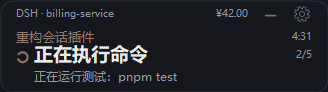

---

## 显示内容

- **项目与会话**：顶栏显示 `DSH · billing-service`，下方是会话名称以及当前具体在做什么。
- **状态**：“思考中…”、“正在执行命令”、“正在读取文件”、“正在搜索网络”、“已启动子代理”等，并附一句简短说明：哪条命令、哪个文件、哪个查询。
- **时间**：当前回合已进行的时长（`4:32`），或刚结束回合的耗时（`用时 3:12`）。
- **计划**：如果代理维护 `todo_write` 清单，状态右侧会显示 `2/5`。
- **等待回答**：状态为“等待你的回答”，并显示问题原文：“把更改提交到哪里？”。
- **确认**：如果 DSH 请求权限，组件会显示“等待确认”以及工具名称。
- **完成与错误**：显示“完成”并预览回答（3 分钟），或显示带红点的“已停止”（如果回合因错误结束）。错误不会因为 DSH 窗口曾获得焦点而消失：它会一直保留到你点击该区块，或直到 `doneVisibleSec` 到期。
- **子代理**：如果父回合已结束但子会话仍在运行，组件不会显示“完成”，而是显示“子代理正在工作”、子代理数量，以及最新一个子代理正在做什么。
- **余额**：顶栏中的可选金额；低于 5 个单位时以琥珀色高亮。
- **完成提示音**：轻柔的声音；出错时播放系统错误提示音。没有弹窗。
- **托盘图标**：带状态颜色和菜单。
- **只在需要时出现**：仅当有工作、等待、子代理或刚出现的“完成”时，组件才可见；当一切结束并查看完毕，它会隐藏，并在有新工作时重新出现。

组件状态：

| 状态 | 外观 |
|---|---|
| 正在工作 | Windows 强调色旋转指示器、回合时间、工具详情 |
| 等待回答 | 琥珀色脉冲圆点、问题文本 |
| 等待确认 | 琥珀色圆点、工具和原因 |
| 子代理正在工作 | 紫色旋转指示器、数量以及最新子代理在做什么 |
| 完成 | 带柔和光晕的绿色圆点、回答预览（默认 3 分钟） |
| 错误 | 带光晕的红色圆点、“已停止”、预览/原因 |
| 空闲 / 离线 | 灰色圆点、“没有活动任务”或“引擎未连接” |

所有状态汇总于一张总览图（演示数据，深色主题）：

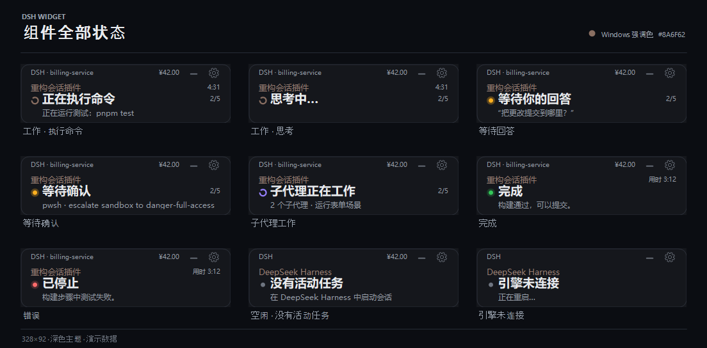

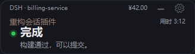
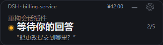
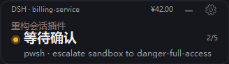
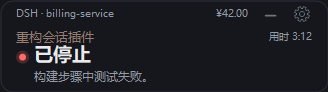
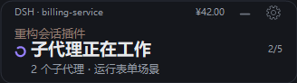

---

## 安装

### 安装程序（推荐）

`DSHWidget-Setup-1.0.0.exe`（约 3 MB），无需管理员权限，会安装到 `%LOCALAPPDATA%\Programs\DSH Widget`。

1. 运行安装程序；如果出现 SmartScreen“未知发布者”警告，请依次点击“更多信息”→“仍要运行”（该文件未使用证书签名）。
2. 选择启动模式（见下文），如有需要，可勾选创建桌面快捷方式。
3. 卸载：“设置 → 应用 → DSH Widget → 卸载”。卸载前组件会关闭，快捷方式和开机启动项会被移除；安装程序会单独询问如何处理 `config.json`。

| 模式 | 会发生什么 |
|---|---|
| **随 DeepSeek Harness 启动**（默认） | 将辅助插件 `dsh-widget-bridge` 安装到 DSH 配置中：DSH 启动时组件出现，并随 DSH 一起关闭。如果插件未生效，组件会在 DSH 关闭 5 分钟后自行退出 |
| **登录 Windows 时** | 在“启动”文件夹中创建快捷方式：组件持续运行，即使 DSH 已关闭。不会安装插件 |
| **仅手动** | 不设置自动启动：通过“开始”菜单中的快捷方式启动组件 |

如果这台电脑上的 DSH 还从未打开过，会跳过插件安装——组件将独立运行，之后可以再安装插件：`tools\install-plugin.ps1`。

### 从压缩包 / 源码安装

1. 解压压缩包，双击 **`start-widget.vbs`**（它会在不显示控制台窗口的情况下启动 PowerShell）。
2. 要创建“开始”菜单和桌面快捷方式，请运行：`powershell -ExecutionPolicy Bypass -File .\install.ps1`。
3. 开机启动：`install.ps1 -Autostart`；移除快捷方式和开机启动：`install.ps1 -Remove`。
4. 重新构建安装程序：`build-installer.ps1`（Inno Setup 6.3+ 仅在构建机上需要）。

---

## 操作

| 操作 | 结果 |
|---|---|
| 拖动组件 | 改变位置，位置会保存到 `config.json` |
| 点击右上角的齿轮 | 打开设置窗口 |
| 点击齿轮旁的“—”按钮 | 将组件最小化到托盘 |
| 左键点击托盘图标 | 显示/隐藏组件 |
| 右键点击组件 | 打开托盘菜单 |
| 点击会话区块 | 如果该会话在单独的 DSH 窗口中打开，则聚焦该窗口（按标题匹配）；否则打开 DSH |
| 双击组件 | 切换到 DeepSeek Harness（或启动它） |
| 右键点击托盘 | “显示/隐藏组件”、“打开 DeepSeek Harness”、“设置…”、“关于”、“刷新余额”、“退出” |
| 双击托盘 | 打开 DeepSeek Harness |

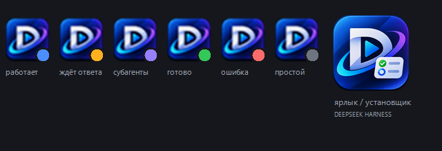

托盘图标是带轨道环的品牌“D”，角落的彩色圆点表示状态：蓝色表示正在工作，紫色表示子代理，琥珀色表示等待回答，绿色表示完成，红色表示错误，灰色表示空闲。

> **托盘图标。** Windows 10/11 默认会把新图标收进“隐藏”区域，也就是时钟旁的 `^` 箭头下。
> 如果看不到图标，请点击 `^`，或前往“设置 → 个性化 → 任务栏 →
> 其他系统托盘图标”启用。此时即使没有托盘，也能使用完整菜单：组件上的齿轮，以及右键点击齿轮。

### 多个 DSH 窗口

活动会话以**同等地位**显示：组件是一个由相同区块组成的堆栈，每个区块都有自己的名称、状态、详情和时间。空闲会话不会进入堆栈，只有正在运行、等待回答和最近完成的会话才会显示。

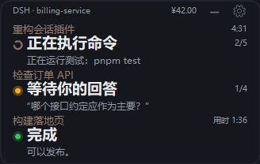

如果活动会话超过可显示数量，则按优先级显示前面的几个，并在底部显示“还有 1 个会话”：

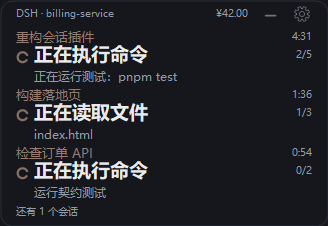

显示多少个会话由“同时显示多少个会话”设置控制（1–3），默认为 3。组件向上扩展，底边保持不动。点击区块会聚焦 DSH 中该会话的单独窗口（如果已打开）；否则只会打开 DSH。组件无法切换 DSH 主窗口内的标签页——DSH 没有为此提供外部 API。

**已查看的任务会自动移除。** 如果带有已完成会话的 DSH 窗口获得焦点（DSH 会将窗口标题设为“<会话> — DeepSeek Harness”），该区块会立即从组件中消失，就像你已经看到过的绿点一样。未查看的区块会保留 `doneVisibleSec` 秒（默认 180 秒）。如果会话中开始新的回合，它会再次出现。

默认情况下选择是“粘性”的：区块不会因为相邻会话的每次事件而重新排序。用于托盘和通知的主会话，只有在当前会话进入休眠，或另一个窗口中的代理提出问题时才会切换。只能通过 `config.json`（`pinnedSessionId`）固定特定会话，UI 中没有单独入口；该值在引擎启动时生效。

---

## 工作原理

```
~/.dsh/sessions/<项目>/<会话>/session.v4.jsonl.zstd
        │  追加写入的 zstd 帧流，内部为 NDJSON 事件
        ▼
widget-engine.js      (Node，无依赖)
   turn/start · step/start · tool/call · tool/result · assistant/message · turn/end · job/*
        │  http://127.0.0.1:45871/status   (仅 localhost，只读)
        ▼
widget-ui.ps1         (PowerShell 5.1 + WinForms)
   组件 · 托盘 · 声音 · 打开 DSH
```

- **不修改 DSH。** 引擎只读取 DSH 本来就会写入磁盘的会话日志，以及用于查询余额的账户授权。组件本身不会改动 DSH 中的任何内容：唯一例外是可选的桥接插件 `dsh-widget-bridge`，它只负责随 DSH 一起启动组件。
- **增量读取：** 首次读取后，引擎只读取新增的字节，而不是整个日志。这一点很重要：日志大小可能达到 8–10 MB。
- **只有余额请求会发往外部**：发送到 `platform.deepseek.com`（或使用你的密钥发送到 `api.deepseek.com`）。其余所有内容都只在 `127.0.0.1` 上运行。
- **适用于任何 DSH**，只要它将会话写入 `%USERPROFILE%\.dsh`（或 `DSH_HOME` 环境变量指定的目录）：桌面应用、`dsh web`、headless。
- Node 来自已安装的 DSH（`...\DeepSeek Harness\resources\runtime\primary-runtime\dependencies\node\bin\node.exe`），无需单独安装任何东西。

为什么读取日志而不使用内部 API：日志中已经包含全部所需信息，包括事件类型、工具名称、参数、时间和回合结束标记，而且它在不同版本之间保持稳定（`session.v4` 格式）。

---

## 隐私与安全

- HTTP 引擎**只监听 `127.0.0.1`**；不返回 CORS 头，带有 `Origin` 和非本机 `Host` 的请求会收到 403。
- 组件会读取：
  - `%USERPROFILE%\.dsh\sessions\**\session.v*.jsonl.zstd` — 会话日志，只读；
  - `%USERPROFILE%\.dsh\.credentials.yaml` — **仅当**启用余额且 `balanceSource = account` 时（`apikey` 和 `off` 模式下不会打开该文件）；
  - 组件文件夹中自己的 `config.json`。
- 令牌不会保存到任何地方，也不会写入日志；请求只会发往授权本身所包含的 issuer，并且仅当它是形如 `*.deepseek.com` 的 `https` 地址时。
- 不收集遥测数据。给朋友的压缩包中不会包含 `config.json`、日志、密钥和用户路径；`release.ps1` 会自行检查，`tools/audit-release.ps1` 会对生成的压缩包再检查一次。

---

## 余额

顶栏金额是可选功能。模式由 `balanceSource` 键设置：

| `balanceSource` | 会发生什么 |
|---|---|
| `account`（默认） | 读取 DeepSeek Harness 已保存在 `%USERPROFILE%\.dsh\.credentials.yaml` 中的授权，并向 `platform.deepseek.com` 查询钱包余额，与 DSH 账户设置中使用的来源相同 |
| `apikey` | 使用 `balanceApiKey` 中的密钥访问官方 `https://api.deepseek.com/user/balance` |
| `off` | 不读取也不请求任何内容，余额隐藏 |

只显示金额。如果刷新失败，组件会保留最后一次已知的数字，但会用波浪号标记：`~¥29.76`。金额为 5 及以下时以琥珀色高亮。如果没有数据或余额已关闭，顶栏不会占据空间，也不会显示短横线。

余额每 `balanceIntervalSec` 刷新一次（默认 300 秒），在每个回合完成后刷新，也可通过托盘图标菜单 →“刷新余额”手动刷新。要完全关闭：设置 `"balance": false`，或在设置中将来源选为“关闭”。

```json
{ "balanceSource": "apikey", "balanceApiKey": "sk-..." }
```

密钥以明文保存在 `config.json` 中，与大多数设置一样。如果对此有顾虑，请使用 `account` 模式：这样就不需要单独的密钥。

---

## 设置

点击组件右上角的齿轮，或托盘 → **“设置…”**。

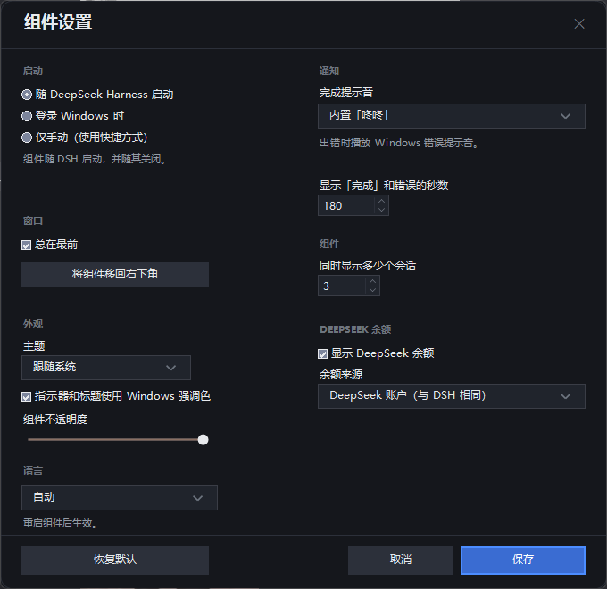

| 部分 | 可设置内容 |
|---|---|
| 启动 | “随 DeepSeek Harness 启动”/“登录 Windows 时”/“仅手动（使用快捷方式）”；下方一行提示会说明所选模式。如果未安装插件，“随 DSH 启动”模式不可用 |
| 窗口 | 总在最前、将组件移回右下角 |
| 外观 | 主题（跟随系统 / 浅色 / 深色）、指示器和标题使用 Windows 强调色、组件不透明度 50–100% |
| 通知 | 完成提示音（内置“咚咚”声 / Windows 系统提示音 / 无声）、显示“完成”和错误的秒数（30–3600 秒） |
| 组件 | 同时显示多少个会话（1–3，全部同等显示） |
| 语言 | 自动 / English / Русский / 简体中文；重启组件后生效 |
| DeepSeek 余额 | 是否显示、余额来源（DeepSeek 账户 / 自己的密钥 / 关闭）、密钥。密钥输入框仅在选择“自己的 DeepSeek 密钥”时出现 |

更改通过“保存”按钮应用，无需重启组件。如果更改余额来源或密钥，余额会立即重新查询。“恢复默认”按钮会恢复默认值，“将组件移回右下角”会把组件放回右下角。

“跟随系统”主题会读取 Windows 设置，并即时跟随切换：

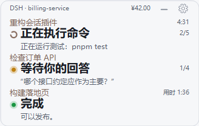

引擎端口和余额刷新间隔不会显示在设置窗口中，只能通过 `config.json` 设置。

## 语言

主要语言为英语，同时提供俄语和简体中文。默认跟随 Windows 界面语言，无法识别时回退到英语。
在 **设置 → 语言** 中切换：自动 / English / Русский / 简体中文。重启组件后生效。组件、托盘、设置和
“关于”窗口均已翻译；DSH 的会话标题、命令和其他数据按原样显示。

## 关于

托盘 → **“关于”**：版本、作者、简短说明、MIT 许可证、GitHub 链接（仓库发布后显示）以及“打开组件文件夹”按钮（`config.json` 和 `widget.log` 也在这里）。右键点击组件也可打开同一菜单。窗口沿用当前主题：浅色或深色。

## config.json

会在脚本旁边自动创建。不会包含在给朋友的压缩包中。

| 键 | 默认值 | 含义 |
|---|---|---|
| `port` | `45871` | 本地引擎端口 |
| `sound` | `true` | 工作完成时播放声音 |
| `soundMode` | `builtin` | `builtin`（内置“咚咚”声）、`system`（Windows）、`off`（无声） |
| `theme` | `system` | 外观：`system` / `light` / `dark` |
| `accentBar` | `true` | 指示器和标题使用 Windows 强调色 |
| `opacity` | `100` | 组件不透明度，%（50–100） |
| `topMost` | `true` | 让组件始终位于其他窗口之上 |
| `x`, `y` | — | 组件位置（拖动时保存） |
| `launchMode` | `''` | `plugin` / `startup` / `manual`，安装时选择的模式 |
| `autostart` | `false` | 反映开机启动状态（“启动”文件夹中的快捷方式） |
| `exitWhenDshClosedMin` | `10` | DSH 关闭后多少分钟组件退出；`0` 表示永不退出。插件模式下安装程序会将其设为 `5` |
| `balance` | `true` | 在组件中显示 DeepSeek 余额 |
| `balanceSource` | `account` | `account` / `apikey` / `off`，余额来源 |
| `balanceApiKey` | `''` | 自己的 DeepSeek 密钥（替代 DSH 账户授权） |
| `balanceIntervalSec` | `300` | 余额刷新频率，秒（最小 60） |
| `doneVisibleSec` | `180` | 显示“完成”和错误的秒数（30–3600） |
| `maxSessions` | `3` | 同时显示多少个会话（1–3） |
| `language` | `auto` | 界面语言：`auto`（跟随 Windows，回退英语）/ `en` / `ru` / `zh-CN` |
| `pinnedSessionId` | `null` | 高级模式中固定的会话（UI 中没有入口） |

---

## 通知声音

默认播放内置声音 `assets\notify.wav`：轻柔的两下木头敲击声（Pixabay，作者 HerrParadox，“Soft Wood Knock Double”；从五下敲击声中保留前两下，单声道 44.1 kHz，处理命令为 `tools/prepare-sound.py --knocks 2 --peak -20`）。Pixabay Content License 许可协议：可免费用于商业用途，无需署名，但不得单独分发该声音本身。

在设置的“通知”部分：

- **内置“咚咚”声**：安装后即可使用；
- **Windows 系统提示音**：标准通知声音；
- **无声**。

回合出错时会播放系统错误提示音。没有单独的“测试”按钮：声音会在下一次任务完成时听到。

注意，这是回合失败时的错误提示音，而不是成功完成时的提示音。当前版本没有“自定义文件”模式；旧配置中的 `soundFile` 会被忽略。

---

## 系统要求

- Windows 10（1809+，x64）和 Windows 11（x64）。已在 Windows 11 上验证；Windows 10 使用代码中的 API/字体回退方案，作者尚未在真实 Windows 10 上实测。
- Windows PowerShell 5.1：系统内置。
- Node 的 `zlib` 需支持 zstd（22.15+；DSH 当前内置 24.x），无需单独安装。

### Windows 10 说明

Windows 11 使用 DWM 圆角窗口。Windows 10 会回退到圆角窗口区域；系统没有 `Segoe UI Variable`，
因此使用 Segoe UI 和 Segoe MDL2 Assets。中文界面使用 Microsoft YaHei UI。不支持 Windows 10 S、
32 位 Windows 和 Windows 10 ARM。兼容性基于 API 和字体回退；作者仅在 Windows 11 上实测。

---

## 限制

- **这不是 Windows 11 小组件板中的小组件。** 该面板只接受带有 Widget Provider 的打包 MSIX 应用（Windows App SDK、包签名、COM 激活器注册）。那是一个独立的 C#/WinUI 构建。这里描述的组件是桌面上的普通窗口：用途相同，但无需安装、签名和管理员权限。
- “正在做什么”只能精确到步骤和工具调用层面。当模型生成文本时，只能看到“思考中…”：在消息完成前，流式文本不会写入日志。
- 子代理树通过子会话日志（`parentSession`、`delegationDepth`）跟踪：组件会等待整棵树稳定下来。如果子代理超过 30 分钟没有事件（“卡住”），它就不再被视为活动。
- 如果打开了多个 DSH 窗口，组件会以堆栈形式显示活动会话，但用于托盘和通知的主会话按“粘性”规则选择。
- 因关闭 DSH 而中断的回合不算当前工作，也不会占用组件。
- 引擎会为诊断而处理后台任务（`job/*`），但不会显示在组件中；已完成回合的历史不会保留。
- 组件按固定 328 px 设计。在 Windows 缩放 125–150% 时，它会由系统整体缩放（略柔和，但不会被裁切）；在 100% 时最清晰。
- 仅支持 Windows：UI 基于 WinForms 构建。

---

## 诊断

```powershell
# 组件当前看到的内容
powershell -ExecutionPolicy Bypass -File .\tools\status.ps1

# 引擎的原始响应
Invoke-RestMethod http://127.0.0.1:45871/status | ConvertTo-Json -Depth 6
```

- “引擎未连接”：找不到 `node.exe`、端口被其他进程占用，或 DSH 还从未启动过。
- 组件空白或显示“没有活动任务”：`%USERPROFILE%\.dsh\sessions` 中还没有会话日志。
- 编辑 `.ps1` 后西里尔字母变成“Сообщение”：文件保存时没有 BOM。请重新保存：`powershell -File .\tools\fix-bom.ps1 -Path .\widget-ui.ps1`。
- 详细日志位于组件旁的 `widget.log`（超过 256 KB 后轮转）。
- **如果直接从 DSH 工作区内的项目文件夹运行，安装程序会提示“无法创建文件夹 …is-*.tmp。错误 5：拒绝访问”**：该文件夹有特殊的 ACL。请将 `DSHWidget-Setup-*.exe` 复制到桌面或“下载”文件夹，并从那里运行；从普通目录安装会正常进行。在接收者的机器上（以及从“下载”文件夹运行时）不会出现这个问题。

---

## 文件

| 文件 | 用途 |
|---|---|
| `widget-engine.js` | 读取会话日志，通过 HTTP 提供状态（Node） |
| `widget-ui.ps1` | 组件、托盘、声音（PowerShell + WinForms） |
| `assets\DSHWidget.ico` | 品牌图标：快捷方式、设置窗口、安装程序 |
| `assets\DSHWidget-Tray.ico` | 简化的托盘图标（状态为彩色圆点） |
| `assets\notify.wav` | 内置完成提示音 |
| `start-widget.vbs` | 无控制台窗口启动 |
| `install.ps1` | 创建“开始”菜单和桌面快捷方式、开机启动 |
| `release.ps1` | 构建 `dsh-widget-1.0.zip`，不含个人数据 |
| `build-installer.ps1`, `installer.iss` | 构建 `dist\DSHWidget-Setup-1.0.0.exe`（需要 Inno Setup） |
| `plugin-src\`, `plugin\` | 辅助桥接插件 `dsh-widget-bridge` |
| `tools\status.ps1` | 便于阅读的引擎状态 |
| `tools\test-subagents.js` | 在合成 DSH_HOME 上测试子代理逻辑 |
| `tools\test-selection.js` | 测试两个活动会话下窗口的“粘性”选择 |
| `tools\test-ack.js` | 测试“已查看”和取消固定 |
| `tools\test-content.js` | 问题、确认、错误、计划、增量读取、CORS |
| `tools\make-previews.ps1` | 重新截取 `docs\<lang>\preview-*.png` |
| `tools\make-states-sheet.ps1` | 生成包含所有状态的单张总览图 `docs\<lang>\preview-states.png` |
| `tools\make-tray-preview.ps1` | 重新生成 `docs\preview-tray.png` |
| `tools\audit-release.ps1` | 检查压缩包中是否含有个人数据 |
| `tools\fix-bom.ps1` | 将脚本重新保存为带 BOM 的 UTF-8 |
| `tools\stop-widget.ps1` | 根据 `runtime.json` 停止组件和引擎 |
| `config.json` | 设置（首次更改时创建，不会包含在压缩包中） |
| `docs\` | README 预览图 |
| `LICENSE`, `CHANGELOG.md` | MIT 许可证和版本历史 |

---

## 构建与检查

```powershell
# 引擎测试
node tools\test-subagents.js
node tools\test-selection.js
node tools\test-ack.js
node tools\test-content.js

# 组件预览图（需要桌面环境和 Windows PowerShell）
powershell -ExecutionPolicy Bypass -File .\tools\make-previews.ps1

# 给朋友的压缩包及其审计
powershell -ExecutionPolicy Bypass -File .\release.ps1 -Version 1.0
powershell -ExecutionPolicy Bypass -File .\tools\audit-release.ps1

# 安装程序
powershell -ExecutionPolicy Bypass -File .\build-installer.ps1 -Version 1.0.0
```


---

## 许可证

代码采用 MIT 许可证，参见 [LICENSE](LICENSE)。DeepSeek Harness 及其名称归其权利人所有；这是一个非官方项目。声音 `assets\notify.wav` 采用 Pixabay Content License 许可协议（参见“通知声音”部分）。

---

## 代码签名政策

免费代码签名由 [SignPath.io](https://about.signpath.io) 提供，证书由
[SignPath Foundation](https://signpath.org) 签发。

签名对象、团队角色、构建来源和人工审批流程见
[CODE_SIGNING_POLICY.md](CODE_SIGNING_POLICY.md)。隐私政策见
[PRIVACY.md](PRIVACY.md)，第三方素材见
[THIRD_PARTY_NOTICES.md](THIRD_PARTY_NOTICES.md)。

## 参与贡献

本地检查和 PR 规则见 [CONTRIBUTING.md](CONTRIBUTING.md)。安全问题请通过
[SECURITY.md](SECURITY.md) 私下报告。

## 发布（供作者使用）

```powershell
# 一次性配置：用于提交的姓名和邮箱
git config --global user.name "您的姓名"
git config --global user.email "<email>"

git init -b main
git add .
git commit -m "DSH Widget 1.0.0"
```

在 GitHub 上创建一个名为 `dsh-widget` 的空仓库，然后：

```powershell
git remote add origin https://github.com/MuratovMikhail/dsh-widget.git
git push -u origin main
```

推送版本标签即可自动发布：

```powershell
git tag -a v1.0.0 -m "DSH Widget 1.0.0"
git push origin v1.0.0
```

`.github/workflows/release.yml` 会构建 `dsh-widget-1.0.zip`、`DSHWidget-Setup-1.0.0.exe` 和
`SHA256SUMS.txt`，然后创建 GitHub Release。无需手动上传文件，也不需要 `gh`。
CI 会在每次 push 时运行引擎测试和编码检查。
